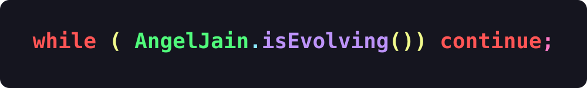

 

  

  <b>First-year Student · Full-Stack Developer · Lifelong Learner</b>

---

### 💻 About Me

- 🌱 Currently learning, building, breaking things, and figuring out how they work.
- 🛠️ Working with the **SERN stack** and **Python**.
- 🧠 Improving my problem-solving skills, one challenge at a time.
- 🤝 Love connecting with people, sharing ideas, and expanding my network.
- 🚀 Always curious about new technologies and the things I can build with them.

### 🧰 Tech Stack

**Languages:** `JavaScript` · `Python` · `HTML` · `CSS`

**Frontend:** `React` · `Vite` · `Tailwind CSS`

**Backend & Databases:** `Node.js` · `Express.js` · `Flask` · `PostgreSQL`

**Tools:** `Git` · `GitHub` · `VS Code` · `Postman`

### 🚀 What I'm Up To

- Building projects that turn what I learn into something real.
- Exploring full-stack development and strengthening my fundamentals.
- Learning to write better code and think through problems more effectively.

### 🤝 Let's Connect

I'm always happy to connect with fellow developers, exchange ideas, and learn something new.

  <i>Still a work in progress — just like the code I write.</i> ✨

